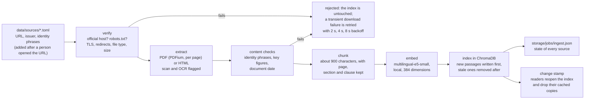
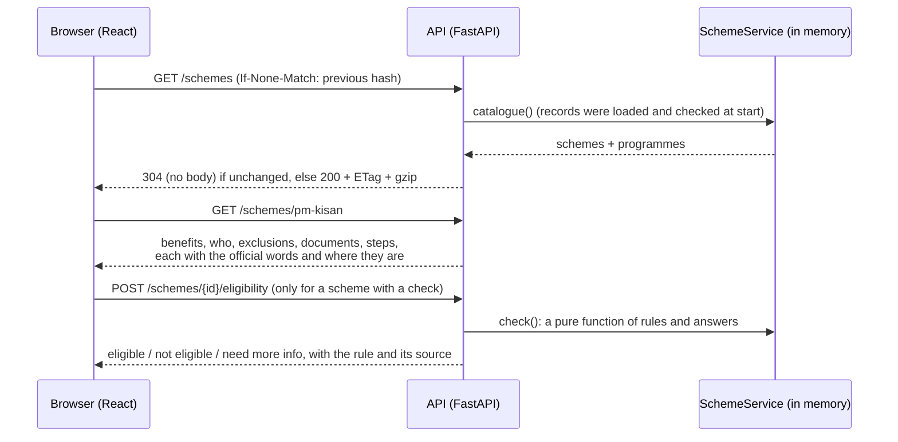
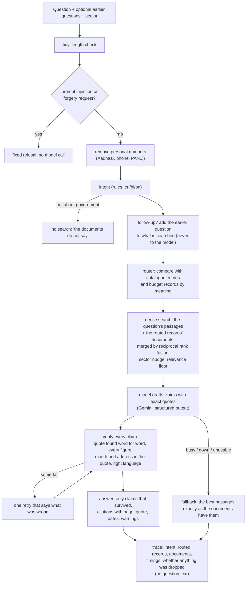

# Data flow

Three journeys: an official document becoming searchable evidence, a citizen browsing a programme, and a citizen asking a question.

## 1. From an official document to searchable evidence (run by a person)

Idempotent: a source's fingerprint (bytes, registry entry, extractor and chunker versions, embedding model) is compared before any work, so running it twice changes nothing. Previous document versions stay in `storage/raw/<id>/` named by hash; the index holds the latest.

## 2. A citizen browses a programme (no model, no login)

Nothing a visitor types is stored or logged. The browser keeps three choices (languages, reading speed) and nothing else.

## 3. A citizen asks a question

The model never sees the earlier questions, a personal number, or text the sanitiser flagged as an instruction. What it writes reaches the user only after the verification.
