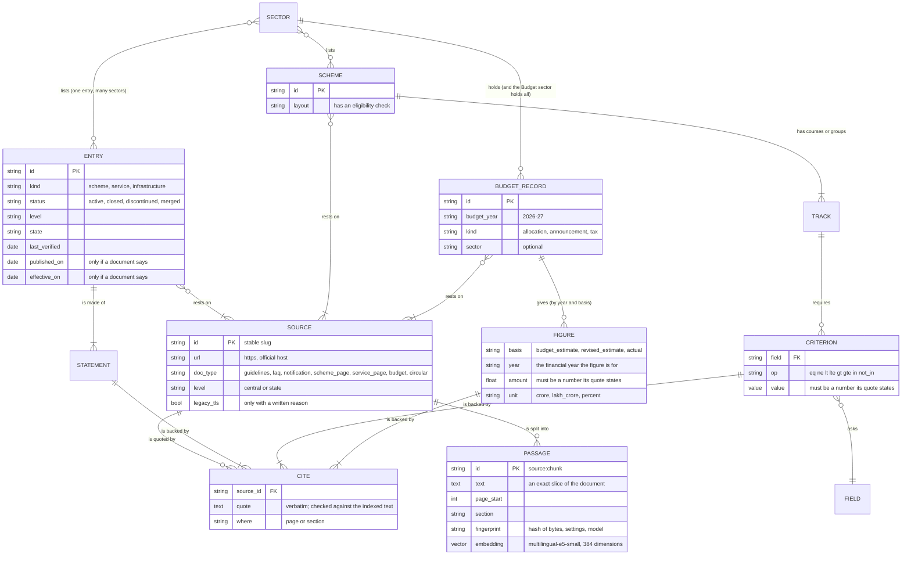

# Data model

CivicSaathi has **no relational database**, and that is a decision, not a gap (see [DECISIONS.md](DECISIONS.md), ADR 1). The data is of two kinds:

- **Records** are TOML files in `backend/data/`, version controlled with the code, validated when loaded, and each statement carries a quote from an official document.
- **The index** is ChromaDB in `backend/storage/chroma/`, built from the official documents by `python -m app.cli ingest`. It is derived data: safe to delete, rebuilt with `ingest --rebuild`.

## Entities and how they relate

## Where each thing lives

| Entity | Stored in | Loaded by | Checked by |
| --- | --- | --- | --- |
| Source | `data/sources/*.toml` | `services/ingestion/registry.py` | `verify` (official host, TLS, file type, identity phrases) |
| Entry | `data/catalogue/*.toml` | `services/catalogue/loader.py` | loader (figures, months, addresses in the quote) and `catalogue-check` (quote in the document) |
| Scheme, track, criterion, field | `data/schemes/*.toml` | `services/eligibility/loader.py` | loader and `schemes-check` |
| Budget record, figure | `data/budget/*.toml` | `services/catalogue/loader.py` | loader (amount in its quote) and `catalogue-check` |
| Passage | ChromaDB | `services/ingestion/pipeline.py` | fingerprint; `ingest` is idempotent |
| Benchmark case | `data/eval/questions.toml` and derived | `services/evaluation/cases.py` | `eval` |

## The rules the data must keep

- **One programme, many sectors, written once.** `sectors` is a list; the same entry appears on each sector page. No programme is duplicated to appear in two places.
- **Every statement has evidence.** An entry or record with a statement whose quote is missing, too short, from a source it does not list, or lacking a figure it states is refused when loaded.
- **Dates are only those a document gives.** `published_on` and `effective_on` are empty unless a document states them; `last_verified` is when a person or `catalogue-check` last confirmed the quotes, never the document's date.
- **A programme that is not running stays, labelled.** `status` is `closed`, `discontinued` or `merged` with a `status_note`; nothing is deleted to make a list look cleaner.
- **Estimates are never actuals.** A budget figure carries its basis and its financial year; a record with no actual figure is flagged as a plan.

## Indexes (the "database indexes")

The index is a vector index plus metadata; what plays the part of a database index here:

| Need | Mechanism |
| --- | --- |
| Find passages by meaning | HNSW (cosine) in Chroma, over 384-dimension vectors |
| Limit to a scheme's or a sector's documents | metadata filter `source_id $in [...]` |
| List sources and counts without scanning every row on every request | the metadata scan is kept until the index's change stamp changes (`VectorStore._metadatas`) |
| Find the catalogue entry a question is about | the entries' text is embedded once; the question is compared with them (`KnowledgeSearch._route`) |
| Look up a scheme or entry by id | in-memory dictionaries built when the data is loaded (`SchemeService`) |

## Migrations

There is no schema to migrate. A change to a record type is a change to its Pydantic model in `app/domain/`; the loader refuses data that no longer fits, and the tests load the real data. A change to what the index holds (the chunker, the extraction, the embedding model) changes the fingerprint, so `ingest` re-processes the affected sources by itself; an embedding model change needs `ingest --rebuild`, and the store refuses to mix models. To roll back, restore the previous commit and run `ingest` (the previous fingerprints differ, so it re-processes), or `ingest --rebuild` for a clean index.
